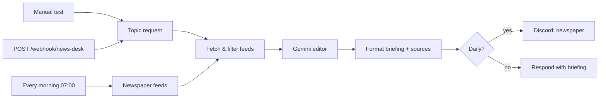

# AI News Desk (n8n)

Two ways to stay informed without doom-scrolling:

1. **On demand** — send a topic and a time window ("AI agents, last 3 days"); get a short, sourced briefing built from Google News.
2. **Daily newspaper** — every morning at 07:00 it reads your own RSS feeds, groups the news into sections and posts a newspaper-style digest to Discord.

Gemini writes the text **only from the fetched items** and cites every story as `[n]`, with the numbered source list attached.



## Setup

1. Credentials in n8n: **Google Gemini (PaLM) API** ([get a key](https://aistudio.google.com/apikey)) and a **Discord Bot** for the daily digest.
2. **Workflows → Import from file** → [`AI_News_Desk.json`](AI_News_Desk.json) and select the credentials.
3. In *Discord: Newspaper* replace `YOUR_DISCORD_SERVER_ID` / `YOUR_DISCORD_CHANNEL_ID` — n8n refuses to run the workflow until these are real IDs (or delete the node if you only use the on-demand mode).
4. Edit the feed list in *Newspaper Feeds* (any RSS or Atom URL, each with a section name).
5. Click **Test workflow** (on-demand demo topic) and activate for the daily edition.

## On-demand usage

```bash
curl -X POST https://<your-n8n>/webhook/news-desk \
  -H "Content-Type: application/json" \
  -d '{"topic": "NIS2 compliance", "days": 7, "language": "English", "max": 15}'
```

| Field | Meaning | Default |
| :--- | :--- | :--- |
| `topic` | Anything Google News can search | demo topic |
| `days` | Time window, 1–30 days | `3` |
| `language` | Language of the briefing | `English` |
| `max` | Max number of stories, up to 40 | `15` |

The response is JSON: `{ title, count, markdown }`.

## How it works

- Feeds are fetched one by one; a failing feed is skipped and reported, it never stops the run.
- Items outside the time window and duplicate headlines (the same story from several outlets) are removed.
- Long digests are split into Discord-sized messages (≤ 1,900 characters).

## Development

[`generate_workflow.py`](generate_workflow.py) builds the JSON; `python test_workflow.py` runs 6 tests (structure, no secrets, time-window clamping, filtering and de-duplication on a sample feed, Discord splitting) with the Code nodes executed in Node.js.

## Costs and limits

- One Gemini 2.5 Flash call per briefing (a fraction of a cent).
- Google News RSS returns headlines and snippets, not full articles, so summaries stay short and you should click through for details.

## Status

Verified on 2026-10-27 on a self-hosted n8n with real feeds and real Gemini calls: on-demand mode (13 stories from the last 3 days) and daily mode (30 stories from 4 feeds, split into 8 Discord messages; the Discord send was disabled for the test); 6 local tests passing.

## License

MIT, see [LICENSE](LICENSE). Built by [CyberResonance](https://cyberresonance.io).
